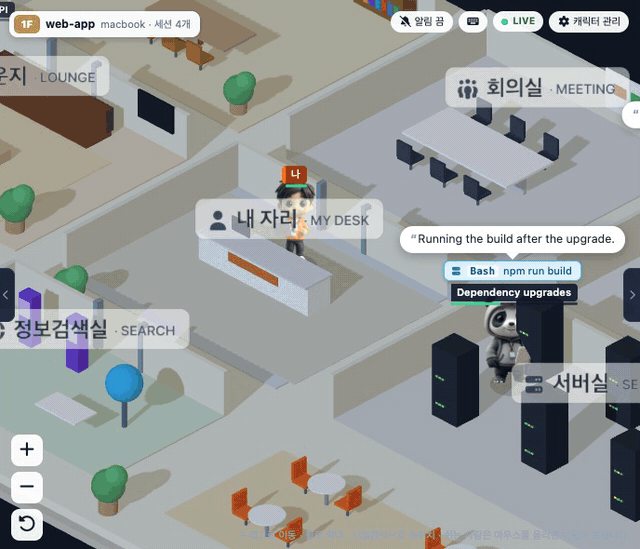
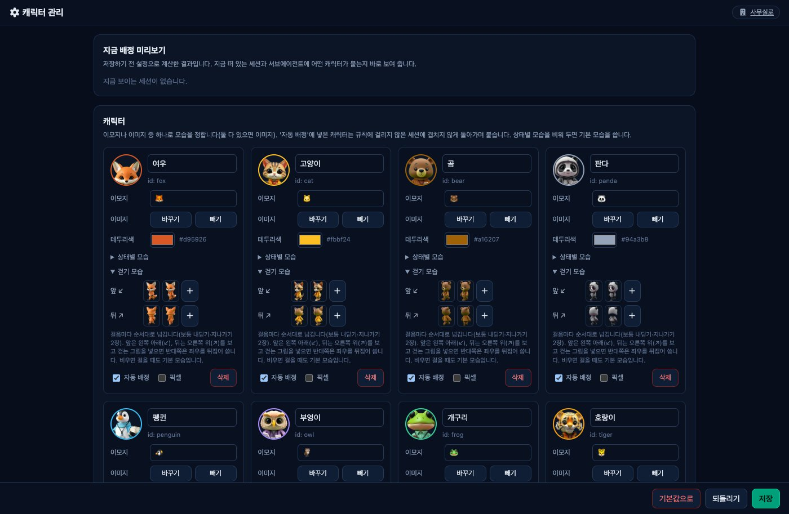

# claude-office

[](https://github.com/royfactory/claude-office/actions/workflows/ci.yml)

[English](README.md) · **한국어**

Claude Code 세션 하나하나를 캐릭터로 띄워, 지금 쓰는 도구에 따라 3D 사무실(쿼터뷰) 안을 걸어 다니게 하는 실시간 대시보드입니다.


<sub>가짜 데이터로 찍은 화면입니다. [MP4](docs/media/demo-ko.mp4)</sub>

세션을 여러 개 동시에 돌리면(worktree, 서브에이전트, 여러 컴퓨터) 어느 세션이 나를 기다리는지 놓치기 쉽습니다. 승인을 기다리는 세션, 방금 끝난 세션, 막힌 세션, 컨텍스트가 얼마나 찼는지, 사용 한도가 얼마나 남았는지를 한 화면에서 봅니다.

- 프로젝트 하나가 빌딩의 한 층이고, 세션과 서브에이전트가 그 층에서 일합니다.
- 파일을 읽으면 자료실, 명령을 돌리면 서버실, 코드를 고치면 개발실로 걸어가고, 쉬면 라운지로 갑니다. 서브에이전트는 엘리베이터로 출퇴근합니다.
- 머리 위에 Claude가 마지막으로 한 말, 지금 하는 일, 세션 제목이 뜹니다.
- 화면은 한국어와 영어를 지원합니다. 기본은 보는 브라우저의 언어를 따르고, 관리 화면 「화면 설정」에서 언어를 고정할 수 있습니다.
- 3D 캐릭터 14종(동물 13 + '나')이 서 있기·걷기 그림과 함께 기본으로 들어 있습니다. 관리 화면에서 이모지나 다른 이미지로 바꿀 수 있고, 걷기 이미지는 걷는 방향(앞·뒤)에 맞춰 걸음마다 번갈아 보입니다. 사람들은 벽과 가구를 피해 문으로 다닙니다.
- 모든 층에서 승인을 기다리거나 일을 마친 세션을 위쪽 칩으로 모아 보여 주고, 원하면 소리로 알립니다. 명찰 아래 막대는 컨텍스트 창 사용량입니다.

```
Claude 를 쓰는 컴퓨터(들)                       허브 (한 대)                    브라우저
~/.claude/sessions, projects ─ 수집기 ─(1초마다 HTTP)─▶ hub :3006 ─(실시간 SSE)─▶ 사무실 화면 /
                                                   설정·캐릭터 이미지 저장          관리 화면 /admin
```

- **수집기**(`collector/`): Claude Code 를 쓰는 컴퓨터마다 하나. 세션 기록을 **읽기만** 하고 요약을 허브로 보냅니다. 파이썬 표준 라이브러리만 씁니다.
- **허브**(`hub/`): 한 대만 있으면 됩니다. 수집기가 보낸 상태를 모아 화면에 실시간으로 뿌리고, 캐릭터 설정과 이미지를 저장합니다.

## 빠른 시작 (한 컴퓨터)

```bash
git clone https://github.com/royfactory/claude-office.git
cd claude-office
cp .env.example .env
docker compose up -d --build     # 허브(도커가 없으면 아래 「운영」의 허브 직접 실행)
sh collector/install.sh          # 수집기(macOS). Windows 는 아래 start.bat 하나로 끝납니다
/usr/bin/python3 hooks/install_hooks.py --rule --todo-tools --apply   # 할 일 체크리스트 규칙(권장)
```

브라우저로 `http://127.0.0.1:3006` 을 엽니다. 자세한 설치와 여러 컴퓨터 구성은 아래에 있습니다.


## 요구 사항

| | 필요한 것 |
|---|---|
| 수집기 (macOS) | `/usr/bin/python3`(명령줄 도구, 없으면 `xcode-select --install`) |
| 수집기 (Windows) | Windows 10/11 + [Python](https://www.python.org/downloads/windows/) 3.9 이상(허브까지 돌리면 3.10 이상, 설치할 때 「py launcher」 포함), PowerShell(기본 설치). 관리자 권한은 필요 없습니다 |
| 수집기 (리눅스) | `python3` 3.9 이상. 직접 실행으로 동작할 것으로 보이나 시험하지 않았습니다 |
| 허브 | Docker(Compose) 또는 [uv](https://docs.astral.sh/uv/). Windows 는 `start.bat` 이 Python 가상환경으로 띄운다 |
| 브라우저 | WebGL 이 되는 최신 브라우저 |

## Windows: 한 컴퓨터에서 한 번에

허브와 수집기를 그 Windows 컴퓨터 안에서 다 돌리는 경우입니다. Docker 는 필요 없습니다.

1. [Python](https://www.python.org/downloads/windows/) 3.10 이상을 설치합니다(설치 화면에서 「py launcher」 포함).
2. 저장소를 받습니다: `git clone https://github.com/royfactory/claude-office.git` (또는 GitHub 의 Code → Download ZIP 을 풀기)
3. 폴더에서 **`start.bat` 을 더블클릭**합니다(Windows 전용 실행 파일입니다).
4. 아래 「꼭 할 것: Claude 전역 지침에 체크리스트 규칙 넣기」를 합니다(`start.bat` 이 끝날 때도 안내합니다).

`start.bat` 이 하는 일:
- `.env` 가 없으면 기본값으로 만듭니다(허브 `127.0.0.1:3006`, 수집기도 그 주소로).
- 저장소의 `.venv` 에 허브 의존성을 설치합니다(처음 한 번 1~2분, 인터넷 필요).
- 허브와 수집기를 작업 스케줄러(`claude-office-hub`, `claude-office-collector`)에 등록하고 띄웁니다. 다음부터는 로그온하면 창 없이 저절로 뜹니다.
- 브라우저로 사무실 화면(`http://127.0.0.1:3006`)을 엽니다.

| 파일 | 하는 일 |
|---|---|
| `start.bat` | 설치·갱신·시작(코드를 `git pull` 한 뒤 다시 누르면 새 코드로 다시 뜬다) |
| `status.bat` | 허브·수집기가 도는지와 최근 로그 |
| `stop.bat` | 둘 다 멈추고 작업 스케줄러 등록을 지움(설정·캐릭터 이미지는 `data\` 에 남음) |

설정·캐릭터 이미지는 `data\`, 허브 로그는 `data\hub.log`, 수집기 로그는 `%USERPROFILE%\.claude-office\collector.log` 에 있습니다.

## 설치 (macOS · 리눅스 · 허브를 서버에 두는 경우)

```bash
git clone https://github.com/royfactory/claude-office.git
cd claude-office
cp .env.example .env          # Windows(PowerShell): copy .env.example .env
```

이제 구성에 따라 A 또는 B 를 따릅니다. 수집기 설치 명령은 OS 마다 다릅니다.

| OS | 수집기 설치·갱신 | 상태 / 내리기 |
|---|---|---|
| macOS | `sh collector/install.sh` | `sh collector/install.sh --status` / `--uninstall` |
| Windows | `powershell -ExecutionPolicy Bypass -File collector\install.ps1` | 같은 명령 뒤에 `-Status` / `-Uninstall` |
| 리눅스 | 아래 「운영」의 직접 실행 | |

### A. 한 컴퓨터에서 다 돌리기 (가장 간단)

`.env` 는 기본값 그대로 둡니다(허브 `127.0.0.1:3006`, 수집기도 그 주소로 보냄).

```bash
docker compose up -d --build          # 허브 (Docker 가 없으면 아래 '허브 직접 실행')
sh collector/install.sh               # 수집기를 상시 실행으로 등록(Windows 는 위 표의 install.ps1)
```

브라우저로 `http://127.0.0.1:3006` 을 엽니다.

### B. 허브는 서버에, 수집기는 여러 컴퓨터에

허브를 한 대(서버, 늘 켜 둔 컴퓨터)에 띄우고, Claude 를 쓰는 컴퓨터마다 수집기를 설치해 그 허브로 보냅니다. 화면도 그 허브 주소로 엽니다.

**1) 허브 컴퓨터** — `.env`:

```bash
OFFICE_BIND=0.0.0.0          # 다른 컴퓨터가 닿게. VPN 주소만 열려면 그 주소(예: Tailscale 100.x.y.z)
OFFICE_PORT=3006
OFFICE_TOKEN=<긴 난수>        # 꼭 정한다: openssl rand -hex 24
```

```bash
docker compose up -d --build
```

> 허브는 HTTPS 를 하지 않습니다. 공용 인터넷에 그대로 열지 말고 VPN(Tailscale 등)이나 사내망 안에서 쓰세요. 앞에 리버스 프록시를 두는 경우 `OFFICE_BIND=127.0.0.1` 로 두고 프록시가 `127.0.0.1:3006` 으로 넘기게 하면 됩니다. 화면은 실시간 스트림(`/api/stream`, SSE)을 쓰니 프록시 버퍼링을 끕니다.

**2) Claude 를 쓰는 컴퓨터마다** — `.env`:

```bash
CLAUDE_OFFICE_HUB=http://<허브 주소>:3006
OFFICE_TOKEN=<허브와 같은 값>
CLAUDE_OFFICE_HOST=work-mac        # 화면에 보일 이름(선택)
```

```bash
sh collector/install.sh              # macOS
sh collector/install.sh --status     # state = running, 로그에 오류가 없으면 됨
```

```powershell
# Windows (저장소 폴더에서 PowerShell)
powershell -ExecutionPolicy Bypass -File collector\install.ps1
powershell -ExecutionPolicy Bypass -File collector\install.ps1 -Status    # 상태 Running, 로그에 오류가 없으면 됨
```

Windows 수집기는 작업 스케줄러 작업 `claude-office-collector` 로 등록되어 로그온할 때마다 창 없이(`pythonw`) 뜨고, 꺼지면 1분 뒤 다시 뜹니다. 코드·설정·로그는 `%USERPROFILE%\.claude-office\` 에 복사되며 `.env` 는 그 사용자만 읽을 수 있게 권한을 좁힙니다.

컴퓨터마다 호스트 이름으로 구분되어 화면 왼쪽 아래 로비에 연결 상태가 뜹니다. 여러 컴퓨터에서 같은 이름의 프로젝트 폴더로 작업하면 그 세션들은 한 층에 같이 섭니다.

### 꼭 할 것: Claude 전역 지침에 체크리스트 규칙 넣기

대시보드의 **할 일 체크리스트**는 각 세션의 Claude 가 할 일 도구로 목록을 만들어야 생깁니다. Claude 는 이걸 늘 만들지는 않으니, **세션을 띄우는 컴퓨터마다** Claude 전역 지침 `~/.claude/CLAUDE.md`(Windows: `%USERPROFILE%\.claude\CLAUDE.md`)에 규칙을 넣습니다. 직접 고칠 필요 없이 저장소 폴더에서 한 줄이면 됩니다(끝에 덧붙이고 백업을 남김, 이미 있으면 그대로, 할 일 도구 켜기도 함께):

```bash
/usr/bin/python3 hooks/install_hooks.py --rule --todo-tools --apply      # Windows: py hooks\install_hooks.py --rule --todo-tools --apply
```

새로 시작하거나 다시 연 세션부터 적용됩니다. 넣는 문장은 이것입니다:

```markdown
## 할 일 체크리스트

- 단계가 2개 이상인 작업은 시작할 때 할 일 도구(`TaskCreate`, 없으면 `TodoWrite`)로 단계 목록을 만들고,
  단계를 시작하고 끝낼 때마다 `TaskUpdate`로 상태(진행 중·완료)를 바꾼다. 한 번에 끝나는 질문·작은 수정에는 만들지 않는다.
```

**새 모델에서는 할 일 도구도 켜야 합니다.** Claude Code 는 할 일 도구(`TaskCreate` 등)를 Opus 4.7·Sonnet 4.6·Haiku 4.5 이하 모델에서만 기본으로 주고, 그보다 새 모델(예: Opus 5.5)에서는 빼 둡니다([문서](https://code.claude.com/docs/en/tools-reference)). 이때는 규칙이 있어도 목록이 생기지 않습니다. 설정 폴더의 `settings.json` 에 `"env": {"CLAUDE_CODE_ENABLE_TODO_TOOLS": "1"}` 을 넣으면 켜집니다(새 세션부터). 직접 고치거나 `install_hooks.py --todo-tools --apply` 로 넣습니다(승인 대기 감지 훅도 함께 들어갑니다).

빠뜨려도 설치 스크립트(`install.sh` · `start.bat`)가 끝날 때 이 문장을 보여 줍니다.

### 설정 점검표 (대시보드 「안내」 탭)

「안내」 탭 맨 위 **설정 점검**이 컴퓨터마다 해야 할 일을 점검할 순서대로 보여 주고, 수집기가 알려 준 실제 상태로 완료·일부·아직을 표시합니다. 맨 위 「다음」은 아직 안 된 첫 항목입니다. 설정 폴더(`~/.claude`, Orca 프로필…)가 여럿이면 폴더마다 명령 한 줄씩(`--settings` 포함)을 복사 버튼과 함께 보여 줍니다.

1. 수집기 연결·최신 버전 (필수)
2. 할 일 체크리스트 규칙 + 할 일 도구 켜기 (필수)
3. 승인 대기 감지 훅 (선택)
4. 대시보드에서 메시지 보내기 (선택, macOS·리눅스)
5. 대시보드에서 권한 허용·거절 (선택)
6. 사용 한도 막대 (선택, 터미널 CLI 세션만)
7. 이 브라우저의 소리·알림 (선택)

수집기는 설정 폴더마다 claude-office 훅·승인 훅·상태 표시줄·할 일 도구 값이 들어 있는지와 `.env` 의 메시지·승인 켜짐 여부만 1분마다 확인해 보냅니다(설정 내용은 보내지 않고, 폴더 경로는 홈을 `~` 로 줄여 보냄).

## 설정 (`.env`)

| 키 | 쓰는 곳 | 기본값 | 설명 |
|---|---|---|---|
| `CLAUDE_OFFICE_HUB` | 수집기 | `http://127.0.0.1:3006` | 세션을 보낼 허브 주소 |
| `CLAUDE_OFFICE_HOST` | 수집기 | 호스트 이름 | 화면에 보일 이 컴퓨터 이름 |
| `CLAUDE_OFFICE_DETAIL` | 수집기 | `basic` | `none` 이면 도구 이름·상태만 보냅니다(파일 이름·말풍선 없음) |
| `CLAUDE_OFFICE_ROOTS` | 수집기 | (없음) | 더 읽을 Claude 설정 폴더. 콜론(`:`)으로 구분 |
| `CLAUDE_OFFICE_APPROVE` | 승인 훅 | (꺼짐) | `on` 이면 대시보드에서 권한 요청을 허용·거절할 수 있습니다(아래 「대시보드에서 허용·거절」) |
| `CLAUDE_OFFICE_CONTEXT_WINDOW` | 수집기 | (자동) | 컨텍스트 게이지의 창 크기(토큰). 비우면 모델 이름의 `[1m]`·`opus-5` 이거나 20만을 넘겨 쓴 적이 있으면 100만, 아니면 20만 |
| `OFFICE_BIND` | 허브 | `127.0.0.1` | 허브를 열 주소 |
| `OFFICE_PORT` | 허브 | `3006` | 허브 포트 |
| `OFFICE_DATA` | 허브(직접 실행) | `./data` | 설정·이미지 저장 폴더. 도커는 볼륨 `office_data` |
| `CLAUDE_OFFICE_MESSAGES` | 수집기 | (꺼짐) | `on` 이면 대시보드에서 이 컴퓨터 세션으로 보낸 메시지를 전달합니다(아래 「세션에 메시지 보내기」) |
| `OFFICE_TOKEN` | 둘 다 | (없음) | 정하면 쓰기 요청(수집기 전송·설정 저장·이미지·메시지)에 필요. 화면은 처음 쓸 때 물어봅니다. 메시지 보내기는 이 값이 있어야 켜집니다 |

`.env` 를 고친 뒤에는 허브는 `docker compose up -d`, 수집기는 설치 명령(`install.sh` / `install.ps1`)을 다시 실행합니다.

수집기가 읽는 Claude 설정 폴더는 `~/.claude`(Windows 는 `%USERPROFILE%\.claude`)와 Orca 프로필(`~/Library/Application Support/orca/claude-profiles/*/home`)입니다. `CLAUDE_CONFIG_DIR` 로 다른 폴더를 쓰는 세션이 있으면 `CLAUDE_OFFICE_ROOTS` 에 더합니다.

## 무엇을 보내나 (개인정보)

수집기는 세션 기록을 읽기만 하고, 허브로는 아래만 보냅니다.

- 세션 이름·제목(Claude Code 가 붙인 `ai-title`), 프로젝트 **폴더 이름**(경로 아님), 상태(근무·고민·휴식), 도구 호출 횟수
- 지금 쓰는 도구 이름과 짧은 대상: 파일 이름(경로 없이), Bash 의 `description`, 검색어 앞 32자, 웹 주소의 호스트 이름, 서브에이전트 설명
- **Claude 가 마지막으로 한 말의 앞 80자**(말풍선)
- 모델 이름, git 브랜치 이름, 토큰 수(지금 컨텍스트 크기·출력 토큰 합), 압축 횟수, Edit·Write 로 더하고 뺀 **줄 수**(내용은 아님). `CLAUDE_OFFICE_DETAIL=none` 이면 브랜치는 빼고 보냅니다
- 5초마다: 그 컴퓨터의 CPU·GPU·메모리·디스크 사용률(%)과 메모리·디스크 전체 크기
- 타임라인용: 최근 30분 동안 쓴 도구 이름·시작·끝 시각·대상(위와 같은 짧은 대상)·실패 여부, 사람이 말을 건 **시각**(내용은 아님)

사용자 메시지, 명령 원문, 파일 내용은 보내지 않습니다. 말풍선은 관리 화면 「화면 설정」에서 끄면 수집기가 30초 안에 보내지 않게 됩니다(허브 설정을 읽지 못할 때도 보내지 않습니다). 대상까지 모두 빼려면 `CLAUDE_OFFICE_DETAIL=none`.

## 화면

**사무실** (`/`)
- 왼쪽 빌딩: 층 = 프로젝트(git 저장소. 저장소 안 하위 폴더나 **git worktree**(예: Orca 작업 폴더)에서 연 세션도 그 저장소 층에 모이고, 세션 탭에 worktree 이름이 보입니다), 창문 = 세션. 근무 중인 층은 불이 켜지고, 창가에 그 세션의 캐릭터가 섭니다. 층을 누르면 그 층이 3D 로 열립니다. 층이 많거나 창이 낮으면 스크롤 없이 들어가도록 층을 한 줄(창문 3개까지)로, 더 좁으면 이름과 근무/세션 숫자만으로 줄여 보여 줍니다.
- **지하층**: 모든 세션이 쉬는 채로 마지막 활동이 1시간을 넘긴 층은 로비 아래 지하(B1·B2…)로 내려가고, 오래 쉰 층일수록 더 깊습니다. 지상에는 일하는 중이거나 최근에 활동한 층만 1F 부터 남습니다. 지하 층의 세션이 다시 일을 시작하면 지상으로 올라옵니다. 지하는 창 없는 콘크리트에 형광등 빛입니다.
- ▶ 재생: 근무 중인 층을 아래층부터 정한 간격(10초~1분)으로 돌아가며 보여 줍니다. 시간이 되면 '나'가 엘리베이터를 타고 다음 층으로 갑니다. 층은 그대로 두고 '나'와 엘리베이터 바닥판만 위로 올라가며 사라지거나, 아래로 갈 때는 엘리베이터 바닥에 구멍이 열리고 그 속으로 내려갑니다(바닥 아래는 잘라 그리지 않음). 층 숫자가 바뀐 뒤 새 층에서 반대쪽으로부터 나타나 멈춥니다.
- 3D 사무실: 드래그로 이동, 휠로 확대, 더블클릭으로 원위치. 캐릭터를 누르면 오른쪽에 상세가 나옵니다.
- 왼쪽(빌딩)·오른쪽(탭) 패널은 3D 화면 양쪽 가장자리 손잡이로 접고 펼칩니다. 「최근 소식」은 위쪽 가장자리를 끌어 높이를 바꾸고, 아주 낮추면 접힙니다(모두 브라우저에 기억).
- **백그라운드 대기**: 턴은 끝났지만 백그라운드 명령·서브에이전트·모니터를 기다리는 세션은 쉬는 것으로 보지 않고 「대기」(청록 배지)로 그 일을 하는 방에 남습니다. 층 불도 켜진 채입니다. 완료 알림(`<task-notification>`)이 오면 풀리고, 알림을 놓쳐도 6시간 뒤에는 풀립니다.
- **승인 대기**(선택): 권한 창을 띄우고 승인을 기다리는 세션은 그 도구의 방에 서서 주황 배지 「승인 대기 · 도구 · n초째」로 보이고(층 불 켜짐, 사람들 목록 「승인」), 들어간 순간 「최근 소식」에 한 줄 남습니다. 그 컴퓨터에 훅을 넣어야 보입니다(아래 「선택: 승인 대기 감지(훅)」).
- **할 일 체크리스트**: 세션의 Claude 가 Claude Code 할 일 도구(`TaskCreate`/`TaskUpdate`, 예전 `TodoWrite`)로 만든 목록을 「세션」 탭에 체크리스트로 보여 줍니다(완료는 취소선, 진행 중은 굵게). 사람들 목록에는 「할 일 3/5」. 보기만 하고 대시보드에서 고치지는 않습니다. Claude 가 목록을 늘 만들게 하려면 위 「꼭 할 것: Claude 전역 지침에 체크리스트 규칙 넣기」를 따릅니다.
- 아래 「최근 소식」: 모든 층의 세션이 일을 마치거나(완료, Claude 의 마지막 말과 함께) 시작한 순간, 새 세션·종료를 최신 순으로 보여 줍니다. 접으면 최근 1시간 완료·시작 수와 가장 최근 소식 한 줄만 보이고, 항목을 누르면 그 층으로 가서 그 세션을 고릅니다. 소식은 화면을 연 뒤부터 쌓이고(처음 열 때는 지금 상태로 채움) 서버에 저장하지 않습니다.
- **컴퓨터 부하**: 빌딩 아래 사용 한도 줄 바로 위에, 지금 보는 층 컴퓨터의 CPU·GPU·메모리·디스크 사용률을 아이콘 게이지 네 칸으로 보여 줍니다(수집기가 5초마다 잼). GPU 는 맥(Apple 실리콘)과 `nvidia-smi` 가 있는 컴퓨터에서만 잽니다.
- **컨텍스트 게이지**: 명찰 아래 얇은 막대가 그 세션이 컨텍스트 창을 얼마나 썼는지 보여 줍니다(65% 넘으면 노랑, 85% 넘으면 빨강 = 곧 자동 압축). 「세션」 탭에는 모델·브랜치·바꾼 줄(+/−)·출력 토큰과 `192k / 1M · 19%` 막대, 압축 횟수가 나오고, 압축된 순간은 「최근 소식」에 한 줄 남습니다. 수집기가 기록의 `usage` 로 셉니다(기록 파일이 32MB 를 넘으면 출력 토큰·줄 수는 끝부분만 센 값).
- **나를 기다리는 세션**: 화면 위 가운데 칩이 모든 층에서 「승인」(권한 승인 대기)·「막힘」·「완료」(화면을 보는 동안 일을 마쳤고 아직 열어 보지 않은 세션) 수를 보여 줍니다. 칩을 누르면 목록이 나오고, 항목을 누르면 그 층으로 가서 그 세션을 고릅니다. 세션을 열어 보면 「완료」에서 빠집니다. 브라우저 탭 제목에도 `(2) Claude 사무실`처럼 승인 + 완료 수가 붙습니다.
- **소리·알림**: 오른쪽 위 종 버튼으로 「알림 끔 → 승인만 → 승인·완료」를 바꿉니다. 고르면 그 소리를 한 번 들려 줍니다. 데스크톱 알림 창은 브라우저가 https·localhost 에서만 허락해서, `http://서버이름:3006` 처럼 열었을 때는 소리와 탭 제목 숫자로만 알립니다.
- **단축키** (`?` 로 목록): `↑` `↓` 위층·아래층(1F 아래는 B1), `1`–`9` 그 층으로, `Space` 순회 재생·정지, `A` 나를 기다리는 다음 세션으로, `F` 최근 소식, `T` 타임라인, `/` 소식 검색, `[` `]` 패널 접기, `M` 소리·알림, `Esc` 선택 풀기.
- **타임라인**: 「최근 소식」 서랍의 「타임라인」으로 바꾸면 세션마다 한 줄씩, 최근 10분·30분 동안 도구를 쓴 구간이 그 방 색 막대로 나옵니다(빗금 = 지금 쓰는 중, 빨간 테두리 = 실패, 흰 세로선 = 내가 말을 건 때). 「이 층」과 「모든 층 · 최근 활동」 중에서 고르고, 막대에 마우스를 올리면 도구·대상·걸린 시간이 보이며, 줄을 누르면 그 세션으로 갑니다. 소식 쪽에는 검색칸과 「승인」 필터가 있습니다.
- 층마다 색조와 채광이 다릅니다(아래층은 아침, 위층은 한낮).

| 방 | 가는 때 (기본 도구) |
|---|---|
| 자료실 | Read · Grep · Glob |
| 개발실 | Edit · Write |
| 서버실 | Bash |
| 정보검색실 | WebFetch · WebSearch · MCP 도구 |
| 회의실 | TodoWrite · Skill · 계획 |
| 내 자리 | AskUserQuestion · Agent(서브에이전트 호출) |
| 라운지 | 쉬는 중 |



**관리** (`/admin`): 캐릭터(이모지·이미지·상태별 모습·걷기 모습), 배정 규칙(프로젝트·세션 이름·서브에이전트 종류·컴퓨터별), 방 이름, 도구 → 방 매핑, 말풍선 켜기/끄기, '나'의 이름과 캐릭터.

걷기 모습은 방향마다 2~4장을 넣습니다(보통 내딛기·지나가기 2장). 카메라가 쿼터뷰로 고정이라 걷는 방향은 화면 대각선 4개뿐이어서,
**앞**은 왼쪽 아래(↙)를 보고 걷는 앞모습, **뒤**는 오른쪽 위(↗)를 보고 걷는 뒷모습만 넣으면 ↘·↖ 는 좌우를 뒤집어 씁니다.
걸음(통통 튀기 한 번)마다 다음 장으로 넘어가고, 멈추면 기본·상태별 모습으로 돌아옵니다. 장마다 캔버스 크기를 같게,
발끝을 아래 가장자리에 맞춰 두어야 키가 흔들리지 않습니다. 기본 캐릭터는 로컬 이미지 모델(FLUX.1 schnell, 걷기는 FLUX.2 klein 편집 + 포즈 뼈대)로 만들었고,
관리 화면의 「기본값으로」를 누르면 처음 상태로 돌아갑니다(이미 저장한 설정이 있으면 새 기본 캐릭터는 이걸 눌러야 나옵니다).



## 세션에 메시지 보내기

사무실 화면에서 세션을 고르면 오른쪽에 「이 세션에 메시지」 칸이 생기고, 거기 쓴 말이 그 세션의 Claude 에게 전달됩니다. 외부 서비스를 거치지 않습니다: 화면 → 허브 → 그 컴퓨터의 수집기 → 세션의 수신함 소켓([Claude Code 교차 세션 메시지](https://code.claude.com/docs/en/cross-session-messaging)).

켜려면 세 가지가 다 있어야 합니다(기본은 모두 꺼짐):

1. 허브 `.env` 에 `OFFICE_TOKEN`
2. 관리 화면 「화면 설정」의 '대시보드에서 세션으로 메시지 보내기'
3. 그 세션이 있는 컴퓨터의 수집기 `.env` 에 `CLAUDE_OFFICE_MESSAGES=on` (그리고 같은 `OFFICE_TOKEN`)

알아 둘 것:
- 받는 Claude 는 이 메시지를 **'다른 세션이 보낸 메시지'** 로 받습니다(내가 터미널에 친 것과 다름). 그래서 권한 승인·설정 변경은 메시지로 할 수 없습니다. 메시지 앞에 「대시보드에서 이 컴퓨터의 사용자가 보낸 메시지」라고 붙여 보냅니다.
- **권한 확인을 건너뛰는 세션**(`--dangerously-skip-permissions`)은 Claude Code 규칙상 그 터미널에 승인 창을 띄우고 기다립니다. 5분 안에 승인하지 않으면 버려집니다. 승인 없이 받게 하려면 그 세션 쪽 Claude Code 설정 `crossSessionInbound` 를 `accept` 로 둡니다(이 컴퓨터의 다른 세션이 보내는 메시지도 모두 받게 되니 판단해서 씁니다).
- 수집기는 허브에 연결을 걸어 두고 기다리다(롱폴링) 메시지가 들어오면 **즉시** 받아 전달합니다. 자기가 보고 있는 세션에만, Claude Code 가 만든 수신함 소켓 경로에만 보냅니다. 1분 안에 수집기가 가져가지 않으면 「만료」가 됩니다.
- Windows 수집기는 아직 메시지 보내기를 지원하지 않습니다(Windows 수신함은 세션별 인증이 필요).

## 선택: 승인 대기 감지(훅)

수집기는 세션 기록만 읽어서는 **세션이 권한 승인을 기다리며 멈춘 순간**(터미널에 「Do you want to …?」 창이 떠 있음)을 알 수 없습니다. 그래서 그냥 '작업 중'으로 보입니다. [Claude Code 훅](https://code.claude.com/docs/en/hooks)을 넣으면 그 순간을 바로 알아 「승인 대기」로 보냅니다. 넣지 않아도 나머지는 지금과 똑같이 동작합니다.

하는 일:
- 훅 스크립트 `hooks/claude_office_hook.py` 가 Claude Code 이벤트(`PreToolUse` · `PermissionRequest` · `PostToolUse` · `PostToolUseFailure` · `PermissionDenied` · `Notification`(`permission_prompt`) · `UserPromptSubmit` · `Stop` · `StopFailure`)마다 불려, 세션별 **마지막 이벤트 하나**만 `~/.claude-office/events/<세션 ID>.json` 에 덮어 씁니다. 예: `{"event": "PermissionRequest", "kind": "permission", "ts": …, "tool_name": "Bash"}`
- 수집기는 마지막 이벤트가 권한 요청이고 세션이 `busy` 이면 그 세션을 「승인 대기」(`kind: approval`)로 보냅니다. 승인해서 도구가 끝나거나, 거절·Stop·새 입력이 오면 풀립니다. 세션이 시작되기 전에 적힌 파일은 무시합니다.

기록하지 않는 것: 명령 원문(`tool_input`), 도구 결과, 사용자 프롬프트, Claude 의 답, 알림 문구, 작업 폴더 경로. 남기는 것은 이벤트 이름·시각·도구 이름뿐이고, **네트워크로 아무것도 보내지 않습니다**(그 컴퓨터의 파일에만 씀). 훅은 결정을 내리지 않고(출력 없음) 어떤 오류에도 exit 0 으로 끝나 Claude Code 를 막지 않습니다. 도구를 쓸 때마다 두 번(시작·끝) 짧은 파이썬 프로세스가 뜹니다(macOS 에서 한 번에 약 0.04초).

설치는 **세션을 띄우는 컴퓨터마다** 저장소 폴더에서 합니다. 먼저 무엇을 넣을지 봅니다(바꾸지 않음):

```bash
/usr/bin/python3 hooks/install_hooks.py            # macOS·리눅스: 미리 보기
/usr/bin/python3 hooks/install_hooks.py --apply    # ~/.claude/settings.json 에 더하기(백업 settings.json.bak-날짜)
/usr/bin/python3 hooks/install_hooks.py --remove   # 이 훅만 빼기(백업을 남김)
```

```powershell
py hooks\install_hooks.py --apply                  # Windows(%USERPROFILE%\.claude\settings.json)
```

- 이미 있는 훅과 다른 설정은 그대로 두고 claude-office 항목만 더하거나 뺍니다. 다시 `--apply` 하면 겹치지 않고 지금 경로로 바꿔 끼웁니다.
- 훅은 설치할 때 돌린 파이썬과 저장소 경로를 적어 둡니다. 저장소 폴더를 옮기면 `--apply` 를 다시 합니다(옮긴 채로 두어도 훅은 조용히 아무것도 안 하고 끝납니다). 다른 파이썬을 쓰려면 `--python <경로>`, Orca 프로필처럼 다른 설정 파일이면 `--settings <경로>`.
- 이미 열린 세션에는 바로 적용되지 않을 수 있습니다. 새 세션의 `/hooks` 에서 들어갔는지 확인합니다.
- 다 뺀 뒤 남은 `~/.claude-office/events/` 는 지워도 됩니다.

### 대시보드에서 허용·거절 (선택, 위 훅에 더해서)

승인 대기 중인 세션의 「세션」 탭에 명령 미리보기와 **「이번만 허용」·「거절」** 버튼이 생깁니다. 자리를 비운 사이 다른 컴퓨터·휴대폰에서 답할 수 있습니다. macOS·Windows 모두 됩니다(소켓이 아니라 HTTP 라서).

- 흐름: 승인 훅 `hooks/claude_office_approve.py`(`PermissionRequest`)가 허브에 요청을 올리고 결정을 기다립니다 → 화면에서 누름 → 훅이 Claude Code 에 `allow`/`deny` 를 돌려줍니다. [문서](https://code.claude.com/docs/en/hooks)대로 **터미널 권한 창은 그동안에도 떠 있고, 터미널에서 먼저 답하면 그쪽이 이깁니다**. 그러면 허브가 몇 초 안에 요청을 거두고 훅은 조용히 끝납니다. 결정이 없으면(10분 가까이 지남·허브 끊김) 훅은 아무것도 돌려주지 않아 평소처럼 터미널에서 묻습니다.
- 허용은 **이번 한 번만**입니다(권한 규칙을 바꾸지 않음). 거절하면 Claude 에게 「대시보드에서 거절했습니다」가 전달됩니다.
- `bypassPermissions`(권한 확인 건너뛰기) 세션은 권한 창 자체가 없어 해당 없습니다.
- 보내는 것: 판단용 미리보기(Bash 는 설명과 명령 앞 400자, 파일 도구는 파일 경로, 웹 도구는 주소, 그 밖은 입력 앞 300자). 허브 메모리에만 두고, 화면에서는 **쓰기 토큰이 있어야** 보입니다.

켜는 조건(모두 필요 — 토큰을 가진 사람이 그 컴퓨터의 명령을 허용할 수 있게 되므로 일부러 여러 겹입니다):
1. 허브 `.env` 의 `OFFICE_TOKEN`
2. 관리 화면 「화면 설정」의 **대시보드에서 권한 요청 허용·거절**(「안내」 탭 점검표의 「지금 켜기」 버튼으로도 됩니다)
3. 그 컴퓨터 `.env` 의 `CLAUDE_OFFICE_APPROVE=on` 후 수집기 설치를 다시 실행(설정을 `~/.claude-office/.env` 로 복사). 한 번에: `sh collector/install.sh --set CLAUDE_OFFICE_APPROVE=on` (Windows `powershell -ExecutionPolicy Bypass -File collector\install.ps1 -Set CLAUDE_OFFICE_APPROVE=on`)
4. 훅 설치에 `--approve`: `/usr/bin/python3 hooks/install_hooks.py --approve --apply` (Windows `py hooks\install_hooks.py --approve --apply`). 승인 대기 감지 훅도 함께 들어갑니다. 한 번 넣으면 다른 옵션으로 다시 `--apply` 해도 남고, 승인 훅만 빼려면 `--no-approve --apply`, 다 빼려면 `--remove`.

### 사용 한도 막대 (선택: 상태 표시줄)

Claude Code 는 구독 계정의 **사용 한도(5시간·주간)**를 [상태 표시줄](https://code.claude.com/docs/en/statusline) 명령에만 알려 줍니다. `hooks/claude_office_statusline.py` 를 상태 표시줄로 걸면 그 값을 `~/.claude-office/status/<세션 ID>.json` 에 남기고(사용률·초기화 시각·컨텍스트 창 크기·모델 이름만), 수집기가 읽어 빌딩 아래에 `사용 ▬ 23% 4h 27m · 주 41%` 한 줄로 보여 줍니다(계정이 여럿이면 `+1`). 누르면 계정마다 5시간·주간 막대, 초기화까지 남은 시간, 설정 폴더, 세션·프로젝트가 나오는 상세 창이 열립니다(Esc 로 닫기). 세션 탭에도 그 세션 계정의 값이 나오고, 컨텍스트 게이지의 창 크기도 짐작 대신 이 값을 씁니다.

```bash
/usr/bin/python3 hooks/install_hooks.py --statusline            # 미리 보기
/usr/bin/python3 hooks/install_hooks.py --statusline --apply    # 걸기(백업, 승인 대기 감지 훅도 함께)
/usr/bin/python3 hooks/install_hooks.py --remove                # 훅을 빼고 상태 표시줄을 원래대로
```

- **원래 쓰던 상태 표시줄은 그대로 보입니다**: 설치할 때 원래 설정을 `~/.claude-office/statusline-next/` 에 적어 두고, 같은 입력으로 이어서 돌려 그 출력을 보여 줍니다. 원래 것이 없었으면 `opus-5-5 · ctx 19% · 5h 42% · 7d 18%` 한 줄을 보여 줍니다.
- **터미널(CLI)에서 연 세션만** 값을 보냅니다. 상태 표시줄은 터미널 화면 기능이라 VS Code 등 IDE 확장으로 연 세션에서는 돌지 않습니다.
- 값은 Pro·Max 구독에서, 세션의 첫 응답 뒤에만 옵니다(API 키 사용자는 없음). 상태 표시줄은 답변이 올 때마다 다시 그려지므로, 오래 쉬는 세션의 값은 마지막으로 받은 값입니다. 초기화 시각이 지난 창은 0% 로 봅니다.
- 같은 계정의 세션들은 주간 초기화 시각이 같아 한 칸으로 묶입니다(컴퓨터마다).
- 상태 표시줄을 다른 도구가 관리하면(예: Orca 프로필의 `settings.json`) 그 도구가 다시 덮어쓸 수 있습니다. 그때는 `--settings <그 설정 파일>` 로 걸되, 덮어써지면 막대가 멈춘다는 것만 알아 둡니다.

## 운영

| 일 | 명령 |
|---|---|
| 업데이트 | `git pull` 후 허브 `docker compose up -d --build`, 수집기는 설치 명령을 다시 |
| 수집기가 무엇을 보내는지 보기 | macOS `/usr/bin/python3 collector/collector.py --dump` · Windows `py -3 collector\collector.py --dump` |
| 허브 로그 | `docker compose logs -f hub` |
| 허브 직접 실행(도커 없이) | `uv run --python 3.12 --with-requirements hub/requirements.txt python hub/app.py` (`.env` 를 읽고, 데이터는 `data/`) |
| 테스트 | `uv run --python 3.12 --with-requirements requirements-dev.txt --with-requirements hub/requirements.txt pytest -q` (수집기만은 `pytest -q tests/test_collector.py`, 3.9 에서도) |
| 리눅스에서 수집기 | `python3 collector/collector.py --env .env` 를 systemd 사용자 서비스 등으로 상시 실행(시험 전) |

로비의 「끊김」: 수집기를 정상으로 멈추면(launchd·systemd 의 중지, Ctrl+C) 허브에 '떠남'을 알려 바로 끊김이 되고, 그 밖의 경우(전원·네트워크가 끊김, Windows 작업 스케줄러의 종료)는 마지막 소식 뒤 30초가 지나면 끊김이 됩니다.

### 잘 안 될 때

- **세션이 안 보임**: `--dump` 에 그 세션이 나오는지 봅니다. 안 나오면 그 세션의 `CLAUDE_CONFIG_DIR` 을 `CLAUDE_OFFICE_ROOTS` 에 더합니다.
- **Windows 에서 `install.ps1` 이 막힘**: 「스크립트를 실행할 수 없습니다」면 위처럼 `-ExecutionPolicy Bypass` 를 붙여 실행합니다. 「Python 3.9 이상을 찾지 못했다」면 python.org 설치본을 설치합니다(Microsoft Store 의 바로가기 `python` 은 쓰지 않습니다).
- **Windows 에서 「허브가 30초 안에 응답하지 않았다」**: `start.bat` 이 실패하면서 진단 실행 결과(허브 오류 출력)를 보여 줍니다. 그 내용과 `data\hub.log` 를 확인합니다. `Address already in use`·`10048` 이면 포트를 다른 프로그램이 쓰고 있으니 `.env` 의 `OFFICE_PORT` 와 `CLAUDE_OFFICE_HUB` 의 포트를 함께 바꿉니다.
- **Windows 에서 세션이 0개**: `py -3 collector\collector.py --dump` 결과를 봅니다. Claude Code 를 WSL 안에서 쓰면 세션 기록이 WSL 쪽에 있으니 수집기도 WSL(리눅스)에서 돌립니다.
- **로비에 컴퓨터가 「끊김」**: 상태 명령(`--status` / `-Status`)의 로그를 봅니다. `HTTP Error 401` 이면 `OFFICE_TOKEN` 이 허브와 다르고, `Connection refused`·시간 초과면 `CLAUDE_OFFICE_HUB` 주소나 허브의 `OFFICE_BIND`·방화벽을 확인합니다.
- **관리 화면에서 저장이 안 됨**: 토큰을 물으면 허브의 `OFFICE_TOKEN` 값을 넣습니다. 잘못 넣었으면 다시 저장할 때 다시 묻습니다.

## 라이선스·출처

[MIT](LICENSE). Anthropic 과 관련 없는 개인 프로젝트입니다. three.js(MIT)를 `hub/static/vendor/` 에 포함합니다 — [LICENSE-three.js.txt](hub/static/vendor/LICENSE-three.js.txt).
Font Awesome Free 7.3.1(solid 아이콘·웹폰트, 아이콘 CC BY 4.0 · 폰트 SIL OFL 1.1 · 코드 MIT)을 `hub/static/vendor/fontawesome/` 에 포함합니다 — [LICENSE.txt](hub/static/vendor/fontawesome/LICENSE.txt).
