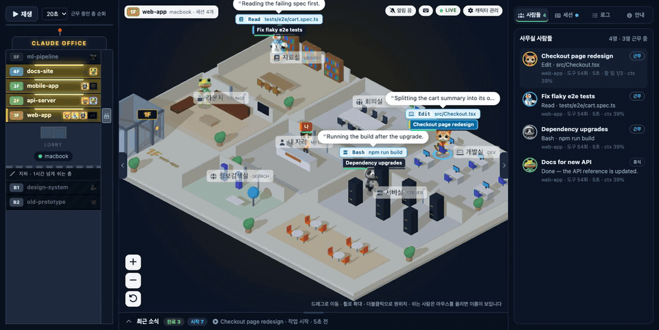
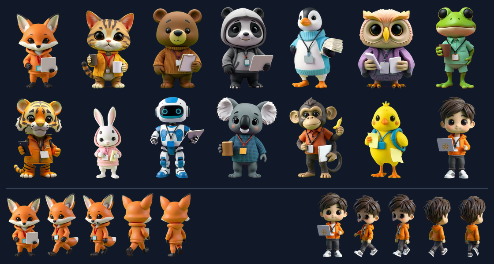

# claude-office

[](https://github.com/royfactory/claude-office/actions/workflows/ci.yml)

**English** · [한국어](README.ko.md)

A live 3D office for your Claude Code sessions. Every session becomes a character that walks to a room for the tool it is using — files in the library, shell in the server room, edits in the dev room — and heads to the lounge when it is done. One project is one floor of the building.



<sub>Demo data. [MP4 version](docs/media/demo.mp4)</sub>

**Why:** when you run several Claude Code sessions at once (worktrees, sub-agents, more than one machine), it is hard to tell which one is waiting for you. claude-office shows it at a glance: who is waiting for a permission prompt, who just finished, who is stuck, how full each context window is, and how much of your usage limit is left.

- **Rooms follow tools.** Read/Grep → library, Edit/Write → dev room, Bash → server room, web and MCP tools → search room, planning → meeting room, idle → lounge. Characters walk around walls and furniture through the doors.
- **Floors are projects.** The building on the left shows every project (git worktrees join their repository's floor). Busy floors light up; floors idle for over an hour sink into the basement. The building shrinks to fit your window without scrolling.
- **What needs you.** A chip at the top gathers every session waiting for approval, stuck, or newly finished, across all floors — with sound and tab-title counts if you want them.
- **Computer load.** CPU, GPU, memory and disk gauges for the computer on the floor you are viewing, right above the usage-limit bar.
- **Daily and weekly summary.** Active time, tool calls, lines changed, output tokens and sessions per project, for today or the last 7 days (Recent activity → Summary). Stored on the hub in `data/stats.json`.
- **Git status per floor.** Uncommitted changes and unpushed commits for each project's checkouts (counts only). On macOS the collector needs Full Disk Access to read repos inside Desktop or Documents; the Guide tab's setup checklist shows how.
- **Session details.** Speech bubbles with Claude's last words, the current tool and target, todo checklists, a context-window gauge, a tool timeline, and a recent-activity feed.
- **Optional extras.** Approve or deny permission prompts from the dashboard, send a message into a session, and show the 5-hour/weekly usage limits.
- **3D characters built in.** 14 characters (13 animals plus "me") with standing and walking frames. Swap any of them for your own images or emoji.

- **English and Korean.** The dashboard follows your browser language by default; pick a fixed language in `/admin` → Display settings.

## Quick start (one computer)

Requirements: Python 3.9+ for the collector, and Docker **or** [uv](https://docs.astral.sh/uv/) for the hub. A browser with WebGL.

**macOS / Linux**

```bash
git clone https://github.com/royfactory/claude-office.git
cd claude-office
cp .env.example .env
docker compose up -d --build     # hub with Docker — or on macOS without Docker: sh hub/install.sh
sh collector/install.sh          # collector, kept running by launchd (macOS)
```

**Windows** — install [Python](https://www.python.org/downloads/windows/) 3.10+ (with the py launcher), clone or download the repository, and double-click **`start.bat`**. It creates `.env`, installs the hub into `.venv`, registers the hub and collector with Task Scheduler, and opens the dashboard. No Docker, no admin rights.

Then open **http://127.0.0.1:3006**.

**Recommended:** make Claude keep a todo list so the dashboard can show a checklist. Run this once per computer (it appends a short rule to `~/.claude/CLAUDE.md` and enables the todo tools, with backups):

```bash
/usr/bin/python3 hooks/install_hooks.py --rule --todo-tools --apply   # Windows: py hooks\install_hooks.py --rule --todo-tools --apply
```

Newer models (e.g. Opus 5.5) do not get Claude Code's todo tools by default; `--todo-tools` adds `CLAUDE_CODE_ENABLE_TODO_TOOLS=1` to `settings.json`. The dashboard's guide tab has a setup checklist that shows what is still missing on each computer.

## Characters



Sessions are assigned characters automatically (no two alike on one floor); sub-agents arrive by elevator as the chick, and "me" sits at the front desk and rides the elevator when the dashboard tours busy floors. In **`/admin`** you can rename characters, use emoji or upload images, set per-state looks (working, thinking, stuck, idle), add walking frames, and write assignment rules by project, session name, sub-agent type, or computer.


Updating from an older version: characters that still have no image get the built-in pictures once, on the first start after the update (`git pull`, then restart the hub — on Windows run `start.bat` again). Images you picked are kept.

Walking frames: the camera is a fixed isometric view, so characters only walk along four diagonals. Add 2–4 frames for walking toward the camera (facing lower-left) and away from it (facing upper-right); the other two directions are mirrored. Keep every frame the same canvas size with the feet on the bottom edge. The built-in characters were made with a local image model (FLUX.1 schnell and FLUX.2 klein edit with pose skeletons).

## How it works

```
Computers running Claude Code                  Hub (one)                      Browser
~/.claude/sessions, projects ─ collector ─(HTTP, every second)─▶ hub :3006 ─(SSE)─▶ office  /
                                                       settings, images           admin   /admin
```

- **Collector** (`collector/`): one per computer that runs Claude Code. It only **reads** session logs and sends a summary to the hub. Standard library only.
- **Hub** (`hub/`): FastAPI + three.js. Collects state from every collector, streams it to browsers, and stores settings and character images.

### Hub on a server, collectors on several computers

Run the hub on an always-on machine and point every collector at it.

Hub `.env`:

```bash
OFFICE_BIND=0.0.0.0        # or a VPN address only, e.g. your Tailscale IP
OFFICE_PORT=3006
OFFICE_TOKEN=<long random> # required here: openssl rand -hex 24
```

Each Claude Code computer's `.env`, then `sh collector/install.sh` (Windows: `powershell -ExecutionPolicy Bypass -File collector\install.ps1`):

```bash
CLAUDE_OFFICE_HUB=http://<hub>:3006
OFFICE_TOKEN=<same value>
CLAUDE_OFFICE_HOST=work-mac   # name shown in the lobby (optional)
```

> [!WARNING]
> The hub does not do HTTPS. Keep it on a VPN (Tailscale etc.) or a private network. Behind a reverse proxy, bind to `127.0.0.1` and turn off buffering for `/api/stream` (SSE).

## What is sent (privacy)

The collector reads session logs and sends only:

- session name and title, project **folder name** (not the path), state, tool-call count
- the current tool and a short target: file name (no path), the Bash `description`, the first 32 characters of a search, the host of a URL, a sub-agent's description
- **the first 80 characters of Claude's last message** (speech bubble)
- model, git branch, number of uncommitted files and unpushed commits, token counts, compactions, lines added/removed by Edit/Write (counts, not content)
- every 5 seconds: CPU, GPU, memory and disk usage percentages of that computer, plus total memory and disk size
- for the timeline: tools used in the last 30 minutes with start/end time, target and failure, and the **times** you sent a message (not the text)

Your prompts, command text, and file contents are never sent. Turn speech bubbles off in `/admin`, or set `CLAUDE_OFFICE_DETAIL=none` to send tool names and states only. Run `python3 collector/collector.py --dump` to see exactly what would be sent.

## Configuration (`.env`)

| Key | Used by | Default | |
|---|---|---|---|
| `CLAUDE_OFFICE_HUB` | collector | `http://127.0.0.1:3006` | hub address |
| `CLAUDE_OFFICE_HOST` | collector | hostname | computer name in the lobby |
| `CLAUDE_OFFICE_DETAIL` | collector | `basic` | `none`: tool names and states only |
| `CLAUDE_OFFICE_ROOTS` | collector | | extra Claude config folders (`CLAUDE_CONFIG_DIR`), colon-separated |
| `CLAUDE_OFFICE_MESSAGES` | collector | off | `on`: deliver dashboard messages to this computer's sessions |
| `CLAUDE_OFFICE_APPROVE` | approval hook | off | `on`: allow approving/denying from the dashboard |
| `CLAUDE_OFFICE_CONTEXT_WINDOW` | collector | auto | context-gauge window size in tokens |
| `OFFICE_BIND` / `OFFICE_PORT` | hub | `127.0.0.1` / `3006` | listen address |
| `OFFICE_DATA` | hub (direct run) | `./data` | settings and images (Docker uses the `office_data` volume) |
| `OFFICE_TOKEN` | both | | required for writes (collector, settings, images, messages) when set |

The collector reads `~/.claude` and Orca profiles (`~/Library/Application Support/orca/claude-profiles/*/home`). After editing `.env`, re-run `docker compose up -d` for the hub and the install command for the collector.

## Optional features

All of these are off unless you turn them on. Details are in the [Korean README](README.ko.md) for now.

| Feature | How |
|---|---|
| **Approval-wait detection.** Show sessions stopped at a permission prompt. A Claude Code hook writes only the last event name and time to a local file; nothing goes over the network. | `python3 hooks/install_hooks.py --apply` (preview without `--apply`, undo with `--remove`) |
| **Approve / deny from the dashboard.** "Allow once" and "Deny" buttons with a command preview. The terminal prompt stays up and whichever answers first wins. | `OFFICE_TOKEN` on the hub, the switch in `/admin`, `CLAUDE_OFFICE_APPROVE=on` on that computer, and `install_hooks.py --approve --apply` |
| **Message a session.** Type into a session from the dashboard. Uses Claude Code's [cross-session messaging](https://code.claude.com/docs/en/cross-session-messaging); macOS/Linux only. | `OFFICE_TOKEN`, the switch in `/admin`, and `CLAUDE_OFFICE_MESSAGES=on` on that computer |
| **Usage-limit bar.** 5-hour and weekly limits from the [status line](https://code.claude.com/docs/en/statusline), per account. Your existing status line keeps working. Terminal (CLI) sessions only. | `install_hooks.py --statusline --apply` |

## Operations

| | |
|---|---|
| Update | `git pull`, then `docker compose up -d --build` and re-run the collector install command (Windows: run `start.bat` again) |
| Collector status | `sh collector/install.sh --status` (Windows `install.ps1 -Status`); `status.bat` on Windows |
| Hub logs | `docker compose logs -f hub` |
| Run the hub without Docker | macOS: `sh hub/install.sh` (LaunchAgent, `--status` / `--uninstall`). Elsewhere: `uv run --python 3.12 --with-requirements hub/requirements.txt python hub/app.py` (reads `.env`, data in `data/`) |
| Tests | `uv run --python 3.12 --with-requirements requirements-dev.txt --with-requirements hub/requirements.txt pytest -q` |
| Linux collector | `python3 collector/collector.py --env .env` under a systemd user service (untested) |

**A session does not show up:** check `collector.py --dump`. If it is missing, add that session's `CLAUDE_CONFIG_DIR` to `CLAUDE_OFFICE_ROOTS`. Using Claude Code inside WSL? Run the collector in WSL too.
**A computer shows as disconnected:** `HTTP Error 401` in the collector log means `OFFICE_TOKEN` differs from the hub; connection refused means check `CLAUDE_OFFICE_HUB`, `OFFICE_BIND`, and the firewall.

## License

[MIT](LICENSE). Bundles [three.js](https://threejs.org/) (MIT, [license](hub/static/vendor/LICENSE-three.js.txt)) and Font Awesome Free 7.3.1 (icons CC BY 4.0, fonts SIL OFL 1.1, code MIT, [license](hub/static/vendor/fontawesome/LICENSE.txt)). Not affiliated with Anthropic.
