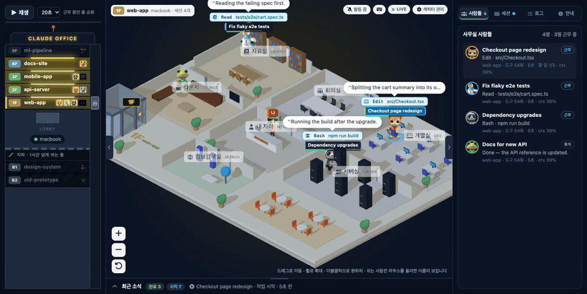
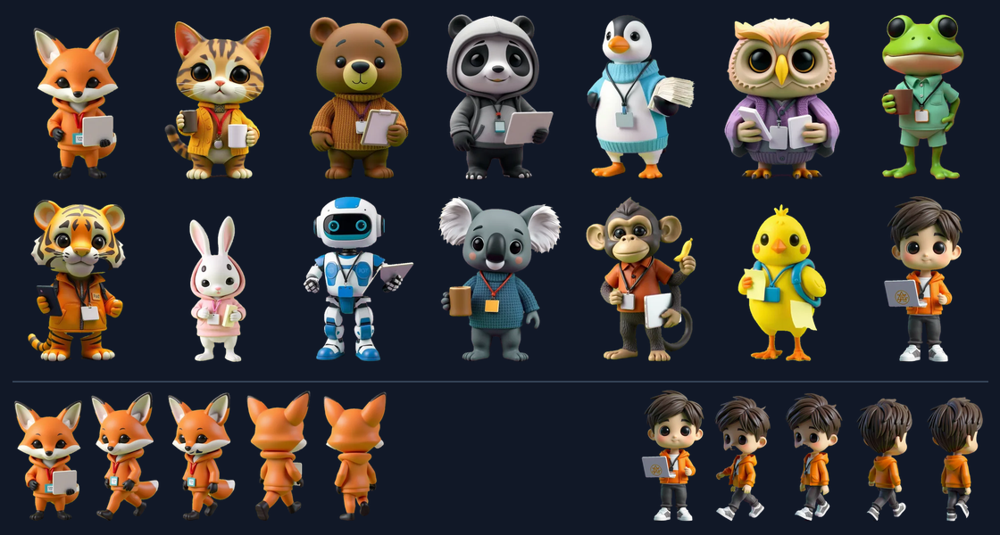
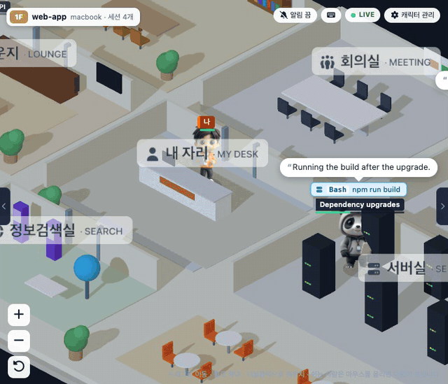
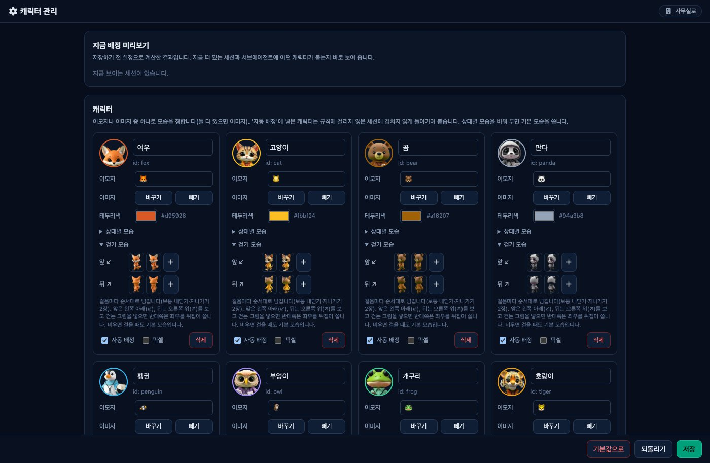

# claude-office

[](https://github.com/royfactory/claude-office/actions/workflows/ci.yml)

**English** · [한국어](README.ko.md) · **[▶ Live demo](https://royfactory.net/claude-office/)** (sample data, no install)

A live 3D office for your Claude Code sessions. Every session becomes a character that walks to a room for the tool it is using — files in the library, shell in the server room, edits in the dev room — and heads to the lounge when it is done. One project is one floor of the building.



<sub>Demo data. [MP4 version](docs/media/demo.mp4)</sub>

**Why:** when you run several Claude Code sessions at once (worktrees, sub-agents, more than one machine), it is hard to tell which one is waiting for you. claude-office shows it at a glance: who is waiting for a permission prompt, who just finished, who is stuck, how full each context window is, and how much of your usage limit is left.

- **Rooms follow tools.** Read/Grep → library, Edit/Write → dev room, Bash → server room, web and MCP tools → search room, planning → meeting room, idle → lounge. Characters walk around walls and furniture through the doors.
- **Floors are projects.** The building on the left shows every project (git worktrees join their repository's floor). Busy floors light up; floors idle for over an hour sink into the basement. The building shrinks to fit your window without scrolling.
- **A window on the city.** The back walls are floor-to-ceiling glass. Outside, the sky follows your local time — dawn glow, clouds, a sunset band, a crescent moon and lit windows at night — higher floors look down on the skyline, and basement floors face concrete. A digital clock on a pillar of the right glass wall shows the time, date and, if the browser allows location, the local weather (Open-Meteo; rain, snow, fog and storms also appear outside). Both can be turned off in `/admin` → Display settings. Preview with `?hour=19&weather=rain`.
- **What needs you.** A chip at the top gathers every session waiting for approval, stuck, or newly finished, across all floors — with sound and tab-title counts if you want them.
- **Computer load.** CPU, GPU, memory and disk gauges for the computer on the floor you are viewing, right above the usage-limit bar. Click the memory gauge for memory by session (process plus children), with sessions idle for over an hour flagged as cleanup candidates.
- **Same-file warning.** When two sessions on one computer edit the same file within ten minutes, a "Same file" chip appears at the top and in both sessions' details.
- **Telegram.** Get approval, done and stuck notifications on your phone, attach one session to a chat and talk to it from Telegram (its last reply of each turn comes back), and optionally approve from Telegram. Linked chats get their own floor at the top of the building.
- **Resume.** Each session's details have a button that copies `cd <folder> && claude --resume <id>` (with `CLAUDE_CONFIG_DIR` for non-default profiles).
- **What's left, in one place.** The right panel is split: this floor (people, session, log) on top, all floors (What's left, Guide) below — drag the handle to resize or double-click to fold. What's left (`L`) lists every session grouped by project: what's waiting on you (approvals, sessions that **asked you a question and stopped**, stuck sessions), remaining todos from Claude's checklists, and uncommitted/unpushed changes. Click a row to jump to that session; `/todo` in Telegram.
- **Replay a day.** The hub records session states every 15 seconds (changes only, `data/timeline/`, kept 14 days). Press Replay at the top to fast-forward any day (60×–3600×, drag the time bar); the sky and wall clock follow the replayed time. Live updates resume when you go back to live.
- **Daily and weekly summary.** Active time, tool calls, lines changed, output tokens and sessions per project, for today or the last 7 days (Recent activity → Summary). Stored on the hub in `data/stats.json`.
- **Git status per floor.** Uncommitted changes and unpushed commits for each project's checkouts (counts only). On macOS the collector needs Full Disk Access to read repos inside Desktop or Documents; the Guide tab's setup checklist shows how.
- **Session details.** Speech bubbles with Claude's last words, the current tool and target, todo checklists, a context-window gauge, a tool timeline, and a recent-activity feed.
- **Optional extras.** Approve or deny permission prompts from the dashboard, send a message into a session, and show the 5-hour/weekly usage limits.
- **3D characters built in.** 14 characters (13 animals plus "me") with standing and walking frames, and looks for thinking (hand on chin), stuck (sweating) and idle (coffee). Swap any of them for your own images or emoji.

- **English and Korean.** The dashboard follows your browser language by default; pick a fixed language in `/admin` → Display settings.

## Quick start (one computer)

**macOS** — one line (clones to `~/claude-office`, starts the hub and the collector with launchd, asks about the checklist rule):

```bash
curl -fsSL https://raw.githubusercontent.com/royfactory/claude-office/main/install.sh | bash
```

**Windows** — one line in PowerShell (needs [Python](https://www.python.org/downloads/windows/) 3.10+ with the py launcher; uses git if you have it, otherwise downloads a zip):

```powershell
irm https://raw.githubusercontent.com/royfactory/claude-office/main/install.ps1 | iex
```

Run the same line again to update. Hub on another machine? `curl … | CLAUDE_OFFICE_HUB=http://server:3006 OFFICE_TOKEN=… bash` installs only the collector.

**By hand** — requirements: Python 3.9+ for the collector, and Docker **or** [uv](https://docs.astral.sh/uv/) for the hub. A browser with WebGL.

**macOS / Linux**

```bash
git clone https://github.com/royfactory/claude-office.git
cd claude-office
cp .env.example .env
docker compose up -d --build     # hub with Docker — or on macOS without Docker: sh hub/install.sh
sh collector/install.sh          # collector, kept running by launchd (macOS)
```

**Windows** — install [Python](https://www.python.org/downloads/windows/) 3.10+ (with the py launcher), clone or download the repository, and double-click **`start.bat`**. It creates `.env`, installs the hub into `.venv`, registers the hub and collector with Task Scheduler, and opens the dashboard. No Docker, no admin rights.

Then open **http://127.0.0.1:3006**.

**Recommended:** make Claude keep a todo list so the dashboard can show a checklist. Run this once per computer (it appends a short rule to `~/.claude/CLAUDE.md` and enables the todo tools, with backups):

```bash
/usr/bin/python3 hooks/install_hooks.py --rule --todo-tools --apply   # Windows: py hooks\install_hooks.py --rule --todo-tools --apply
```

Newer models (e.g. Opus 5.5) do not get Claude Code's todo tools by default; `--todo-tools` adds `CLAUDE_CODE_ENABLE_TODO_TOOLS=1` to `settings.json`. The dashboard's guide tab has a setup checklist that shows what is still missing on each computer.

## Characters



Sessions are assigned characters automatically (no two alike on one floor); sub-agents arrive by elevator as the chick, and "me" sits at the front desk and rides the elevator when the dashboard tours busy floors. In **`/admin`** you can rename characters, use emoji or upload images, set per-state looks (working, thinking, stuck, idle), add walking frames, and write assignment rules by project, session name, sub-agent type, or computer.





Updating from an older version: characters that still have no image get the built-in pictures once, on the first start after the update (`git pull`, then restart the hub — on Windows run `start.bat` again). Images you picked are kept.

Walking frames: the camera is a fixed isometric view, so characters only walk along four diagonals. Add 2–4 frames for walking toward the camera (facing lower-left) and away from it (facing upper-right); the other two directions are mirrored. Keep every frame the same canvas size with the feet on the bottom edge. The built-in characters were made with a local image model (FLUX.1 schnell and FLUX.2 klein edit with pose skeletons).

## How it works

```
Computers running Claude Code                  Hub (one)                      Browser
~/.claude/sessions, projects ─ collector ─(HTTP, every second)─▶ hub :3006 ─(SSE)─▶ office  /
                                                       settings, images           admin   /admin
```

- **Collector** (`collector/`): one per computer that runs Claude Code. It only **reads** session logs and sends a summary to the hub. Standard library only.
- **Hub** (`hub/`): FastAPI + three.js. Collects state from every collector, streams it to browsers, and stores settings and character images.

### Hub on a server, collectors on several computers

Run the hub on an always-on machine and point every collector at it.

Hub `.env`:

```bash
OFFICE_BIND=0.0.0.0        # or a VPN address only, e.g. your Tailscale IP
OFFICE_PORT=3006
OFFICE_TOKEN=<long random> # required here: openssl rand -hex 24
```

Each Claude Code computer's `.env`, then `sh collector/install.sh` (Windows: `powershell -ExecutionPolicy Bypass -File collector\install.ps1`):

```bash
CLAUDE_OFFICE_HUB=http://<hub>:3006
OFFICE_TOKEN=<same value>
CLAUDE_OFFICE_HOST=work-mac   # name shown in the lobby (optional)
```

> [!WARNING]
> The hub does not do HTTPS. Keep it on a VPN (Tailscale etc.) or a private network. Behind a reverse proxy, bind to `127.0.0.1` and turn off buffering for `/api/stream` (SSE).

## What is sent (privacy)

The collector reads session logs and sends only:

- session name and title, project **folder name** (not the path), state, tool-call count
- the current tool and a short target: file name (no path), the Bash `description`, the first 32 characters of a search, the host of a URL, a sub-agent's description
- **the first 80 characters of Claude's last message** (speech bubble)
- which Claude account each config folder is logged into: a short hash of the account id and a masked email (`ro***@example.com`; hash only with `CLAUDE_OFFICE_DETAIL=none`), so usage limits are grouped per account. Nicknames can be set in `/admin`
- model, git branch, number of uncommitted files and unpushed commits, token counts, compactions, lines added/removed by Edit/Write (counts, not content)
- every 5 seconds: CPU, GPU, memory and disk usage percentages of that computer, plus total memory and disk size
- for the timeline: tools used in the last 30 minutes with start/end time, target and failure, and the **times** you sent a message (not the text)

Your prompts, command text, and file contents are never sent. Turn speech bubbles off in `/admin`, or set `CLAUDE_OFFICE_DETAIL=none` to send tool names and states only. Run `python3 collector/collector.py --dump` to see exactly what would be sent.

## Configuration (`.env`)

| Key | Used by | Default | |
|---|---|---|---|
| `CLAUDE_OFFICE_HUB` | collector | `http://127.0.0.1:3006` | hub address |
| `CLAUDE_OFFICE_HOST` | collector | hostname | computer name in the lobby |
| `CLAUDE_OFFICE_DETAIL` | collector | `basic` | `none`: tool names and states only |
| `CLAUDE_OFFICE_ROOTS` | collector | | extra Claude config folders (`CLAUDE_CONFIG_DIR`), colon-separated |
| `CLAUDE_OFFICE_MESSAGES` | collector | off | `on`: deliver dashboard messages to this computer's sessions |
| `CLAUDE_OFFICE_APPROVE` | approval hook | off | `on`: allow approving/denying from the dashboard |
| `CLAUDE_OFFICE_CONTEXT_WINDOW` | collector | auto | context-gauge window size in tokens |
| `OFFICE_BIND` / `OFFICE_PORT` | hub | `127.0.0.1` / `3006` | listen address |
| `OFFICE_DATA` | hub (direct run) | `./data` | settings and images (Docker uses the `office_data` volume) |
| `OFFICE_TOKEN` | both | | required for writes (collector, settings, images, messages) when set |
| `OFFICE_READ_TOKEN` | hub | | when set, viewing (dashboard, admin, state, summary, replay) also needs a token; browsers remember it for a year. `OFFICE_TOKEN` works too |
| `OFFICE_TELEGRAM_TOKEN` | hub | | Telegram bot token from @BotFather; turns on the Telegram bridge |

The collector reads `~/.claude` and Orca profiles (`~/Library/Application Support/orca/claude-profiles/*/home`). After editing `.env`, re-run `docker compose up -d` for the hub and the install command for the collector.

## Optional features

All of these are off unless you turn them on. Details for each follow the table.

| Feature | How |
|---|---|
| **Approval-wait detection.** Show sessions stopped at a permission prompt. A Claude Code hook writes only the last event name and time to a local file; nothing goes over the network. | `python3 hooks/install_hooks.py --apply` (preview without `--apply`, undo with `--remove`) |
| **Approve / deny from the dashboard.** "Allow once" and "Deny" buttons with a command preview. The terminal prompt stays up and whichever answers first wins. | `OFFICE_TOKEN` on the hub, the switch in `/admin`, `CLAUDE_OFFICE_APPROVE=on` on that computer, and `install_hooks.py --approve --apply` |
| **Message a session.** Type into a session from the dashboard. Uses Claude Code's [cross-session messaging](https://code.claude.com/docs/en/cross-session-messaging); macOS/Linux only. | `OFFICE_TOKEN`, the switch in `/admin`, and `CLAUDE_OFFICE_MESSAGES=on` on that computer |
| **Telegram.** One-line notifications for approvals, finished turns (longer than a threshold) and stuck sessions (details stay on the dashboard); reply to a notification to message that session; `/status` and `/use N` to attach a session so the chat talks to it and each turn's last reply comes back; optional Allow/Deny buttons. The hub long-polls Telegram, so it doesn't need to be reachable from the internet. Linking needs a one-time code from `/admin`, private chats only. Quiet hours pause done/stuck notifications (approvals still come by default). Sessions in bypass-permissions mode hold incoming messages for terminal approval; start a Telegram session with `sh scripts/telegram-session.sh <folder>` (`claude --settings '{"crossSessionInbound":"accept"}'`, that session only) — `/status` marks it 📨. Notification text, your Telegram messages and the attached session's replies pass through Telegram's servers. | `OFFICE_TELEGRAM_TOKEN` in the hub `.env`, restart the hub, then `/admin` → Telegram → Get a link code. Messaging (above) is needed to talk to a session |
| **Phone on the same Wi-Fi.** Scan a QR from `/admin` to register a phone (view only, or approve & message); add it to the home screen. | `OFFICE_BIND=0.0.0.0` + `OFFICE_READ_TOKEN` |
| **Read lock.** Require a token to view the dashboard (sign-in page, one-year cookie). | `OFFICE_READ_TOKEN` in the hub `.env` |
| **Usage-limit bar.** 5-hour and weekly limits from the [status line](https://code.claude.com/docs/en/statusline), per account. Your existing status line keeps working. Terminal (CLI) sessions only. | `install_hooks.py --statusline --apply` |

### Approval-wait detection (hook)

Reading session logs alone, the collector can't tell that a session is stopped at a permission prompt ("Do you want to …?") — it looks busy. A [Claude Code hook](https://code.claude.com/docs/en/hooks) fixes that:

- `hooks/claude_office_hook.py` runs on Claude Code events (`PreToolUse`, `PermissionRequest`, `PostToolUse`, `PostToolUseFailure`, `PermissionDenied`, `Notification` (`permission_prompt`), `UserPromptSubmit`, `Stop`, `StopFailure`) and overwrites **only the last event** per session in `~/.claude-office/events/<session id>.json`, e.g. `{"event": "PermissionRequest", "kind": "permission", "ts": …, "tool_name": "Bash"}`.
- If that event is a permission request and the session is busy, the collector reports it as waiting for approval. Approving, denying, stopping or a new prompt clears it.
- Not recorded: command text, tool output, prompts, Claude's replies, notification text, folder paths. **Nothing goes over the network.** The hook never decides anything and always exits 0.

Install on **each computer that runs sessions**, from the repository folder:

```bash
/usr/bin/python3 hooks/install_hooks.py            # preview (macOS/Linux)
/usr/bin/python3 hooks/install_hooks.py --apply    # add to ~/.claude/settings.json (backs it up)
/usr/bin/python3 hooks/install_hooks.py --remove   # remove only these hooks
py hooks\install_hooks.py --apply                  # Windows
```

Existing hooks and settings are kept. Re-run `--apply` after moving the repository; use `--settings <file>` for other config folders (e.g. Orca profiles) and check `/hooks` in a new session.

### Approve or deny from the dashboard

Sessions waiting for approval get a command preview and **Allow once** / **Deny** in the Sessions tab, so you can answer from another computer or a phone. Works on macOS and Windows (HTTP, not sockets).

- The approval hook `hooks/claude_office_approve.py` (`PermissionRequest`) posts the request to the hub and waits. The terminal prompt stays up; **whichever answers first wins**, and the hub withdraws the request within seconds. With no decision (about 10 minutes, or the hub is down) the hook returns nothing and the terminal asks as usual.
- Allow is for **this call only** (permission rules don't change). Deny tells Claude it was denied from the dashboard. Bypass-permissions sessions have no prompts, so this doesn't apply.
- The preview (Bash description and the first 400 characters of the command, the file path, the URL, or the first 300 characters of other input) stays in hub memory and needs the write token to view.

Turn on all four (deliberately layered, since a token holder can allow commands on that computer): `OFFICE_TOKEN` on the hub; **Approve or deny from the dashboard** in `/admin`; `CLAUDE_OFFICE_APPROVE=on` on that computer (`sh collector/install.sh --set CLAUDE_OFFICE_APPROVE=on`, Windows `powershell -ExecutionPolicy Bypass -File collector\install.ps1 -Set CLAUDE_OFFICE_APPROVE=on`); and `install_hooks.py --approve --apply`.

### Message a session

Select a session and a "Message this session" box appears. Text goes dashboard → hub → that computer's collector → the session's inbox socket ([cross-session messaging](https://code.claude.com/docs/en/cross-session-messaging)); no outside service.

- Needs `OFFICE_TOKEN`, **Send messages from the dashboard** in `/admin`, and `CLAUDE_OFFICE_MESSAGES=on` on that computer.
- Claude receives it as **a message from another session** (prefixed "sent from the claude-office dashboard"), so it can't approve permissions or change settings.
- Sessions in bypass-permissions mode hold such messages for approval in their terminal (dropped after 5 minutes) unless `crossSessionInbound` is `accept` for that session — `scripts/telegram-session.sh` starts one that way.
- The collector long-polls the hub and delivers immediately; undelivered messages expire after a minute. Not supported by the Windows collector yet (Windows inboxes need per-session authentication).

### Telegram

1. Create a bot: send `/newbot` to `@BotFather` in Telegram and copy the token.
2. Put `OFFICE_TELEGRAM_TOKEN=<token>` in the hub `.env` and restart the hub (`sh hub/install.sh`, `start.bat`, or `docker compose up -d`).
3. `/admin` → Telegram → **Get a link code**, then send the 6-digit code to the bot (the "open on phone" link sends it for you). Only private chats can link; several people can each link their own chat and pick which computers/accounts notify them.

What you get:

- **Notifications**, one line each: waiting for approval, done (turns longer than 60 seconds by default), stuck. Pick types, the threshold and detail level in `/admin`. **Reply** to a notification to message that session.
- **One session in Telegram**: `/status` (numbered list, ready-to-receive sessions first) then `/use N`, or **Attach to Telegram** in a session's details. What you write goes to that session, and **each turn's last reply** comes back as one line (floor, session title, first sentence); `/more` sends the full reply, formatted (or set Reply format to Full in `/admin`). `/stop` detaches. Attached sessions move to a "Telegram" floor at the top, with the bot assistant in the meeting room and linked people in the lounge.
- **Quiet hours**: a time range (hub computer's time, may cross midnight) when only the chosen notifications are sent (approvals by default). Attached-session replies always come.
- **Approve from Telegram** (off by default): Allow once / Deny buttons with the command preview. Needs dashboard approvals (above) too.
- **Telegram session**: `sh scripts/telegram-session.sh <folder> [claude args]` starts `claude --settings '{"crossSessionInbound":"accept"}'`, so only that session accepts messages without terminal approval, even in bypass mode; `/status` marks it 📨. Messages are never treated as your consent, so its own permission prompts still appear (turn on Telegram approvals or start it with e.g. `--permission-mode acceptEdits`).
- Other commands: `/todo` (what's left, waiting-on-you first), `/more`, `/status all`, `/mute` · `/unmute`, `/unlink`, `/help`.

The bot token lives only in `.env`; linked chats are stored in `data/telegram.json` (not public). Replies are sent by the collector **only for the attached session** and never appear in the public state. Notification text, your Telegram messages and replies pass through Telegram's servers — use the "event and floor only" detail level and turn replies off if that matters.

### Usage-limit bar (status line)

Claude Code reports subscription usage limits (5-hour and weekly) only to the [status line](https://code.claude.com/docs/en/statusline). With `hooks/claude_office_statusline.py` as the status line, those values (usage, reset times, context window size, model name only) are saved to `~/.claude-office/status/<session id>.json` and shown under the building as `Usage ▬ 23% 4h 27m · wk 41%` (`+1` with more accounts). Click it for per-account bars and reset times.

```bash
/usr/bin/python3 hooks/install_hooks.py --statusline            # preview
/usr/bin/python3 hooks/install_hooks.py --statusline --apply    # install (also adds the approval-wait hook)
/usr/bin/python3 hooks/install_hooks.py --remove                # remove and restore your status line
```

- **Your existing status line keeps showing**: it is saved and run with the same input. Without one, a single line like `opus-5-5 · ctx 19% · 5h 42% · 7d 18%` is shown.
- Terminal (CLI) sessions only — IDE extensions don't run the status line. Values come with Pro/Max subscriptions after a session's first reply; long-idle sessions keep their last value.
- If another tool manages the status line (e.g. an Orca profile's `settings.json`), install with `--settings <that file>`; if it gets overwritten, the bar stops updating.

### Phone on the same Wi-Fi

Open the dashboard in a phone browser without opening anything to the internet. Set `OFFICE_BIND=0.0.0.0` and `OFFICE_READ_TOKEN` (read lock) in the hub `.env` and restart the hub (turn off any `tailscale serve` on the same port — they collide, and the hub then answers on the tailnet directly). In `/admin` → Phone, pick View only or Approve & message, press Make QR and scan it with the phone; it gets a one-year device cookie (only its hash is stored in `data/devices.json`) and can be disconnected from `/admin`. Use "Add to Home screen" to run it like an app. Office or café Wi-Fi may block devices from reaching each other.

### Read lock

Set `OFFICE_READ_TOKEN` on the hub and viewing also needs a token: `/` and `/admin` show a sign-in page, and the token (or `OFFICE_TOKEN`) sets a signed, HttpOnly cookie for a year. Give viewers the read token; they can't write with it. Collectors read settings with their write token. Screen code (`/static`) and character images stay public.

## Operations

| | |
|---|---|
| Update | `git pull`, then `docker compose up -d --build` and re-run the collector install command (Windows: run `start.bat` again) |
| Collector status | `sh collector/install.sh --status` (Windows `install.ps1 -Status`); `status.bat` on Windows |
| Hub logs | `docker compose logs -f hub` |
| Run the hub without Docker | macOS: `sh hub/install.sh` (LaunchAgent, `--status` / `--uninstall`). Elsewhere: `uv run --python 3.12 --with-requirements hub/requirements.txt python hub/app.py` (reads `.env`, data in `data/`) |
| Tests | `uv run --python 3.12 --with-requirements requirements-dev.txt --with-requirements hub/requirements.txt pytest -q` |
| Linux collector | `python3 collector/collector.py --env .env` under a systemd user service (untested) |

**A session does not show up:** check `collector.py --dump`. If it is missing, add that session's `CLAUDE_CONFIG_DIR` to `CLAUDE_OFFICE_ROOTS`. Using Claude Code inside WSL? Run the collector in WSL too.
**A computer shows as disconnected:** `HTTP Error 401` in the collector log means `OFFICE_TOKEN` differs from the hub; connection refused means check `CLAUDE_OFFICE_HUB`, `OFFICE_BIND`, and the firewall.

## License

[MIT](LICENSE). Bundles [three.js](https://threejs.org/) (MIT, [license](hub/static/vendor/LICENSE-three.js.txt)) and Font Awesome Free 7.3.1 (icons CC BY 4.0, fonts SIL OFL 1.1, code MIT, [license](hub/static/vendor/fontawesome/LICENSE.txt)). Not affiliated with Anthropic.
